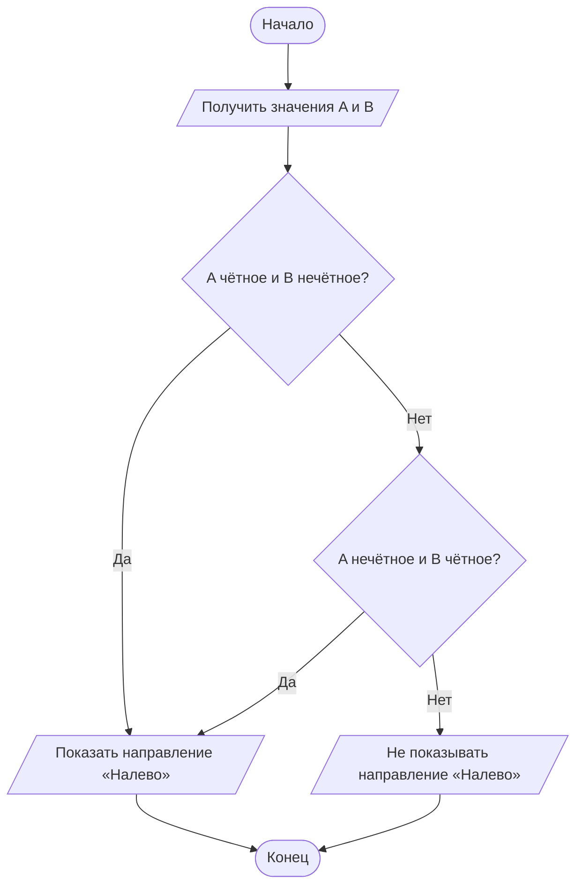

# **Домашнее задание к работе 4**

## Условие задачи

На развилке дорог стоит знак. Он показывает направление «Налево», если только одно из двух чисел (`A` или `B`), полученных от датчиков traffic flow, является чётным. Записать условие для показа направления «Налево».

## Блок-схема алгоритма

## Ответ

Условие для показа направления «Налево»: ровно одно из чисел `A` и `B` должно быть чётным.

## Информация о разработчике 
                                Запорин Артём, бТИИ-262
